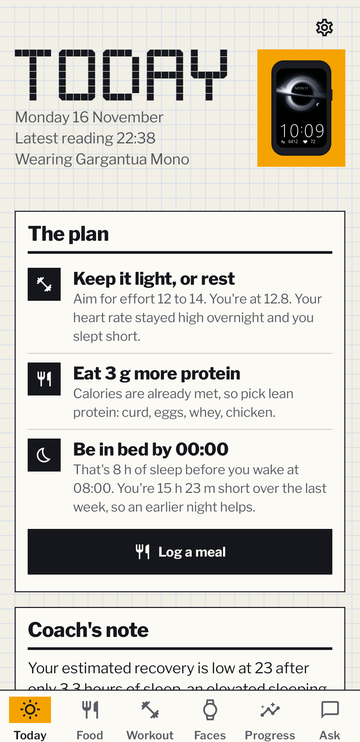
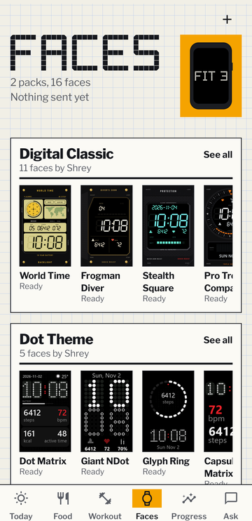
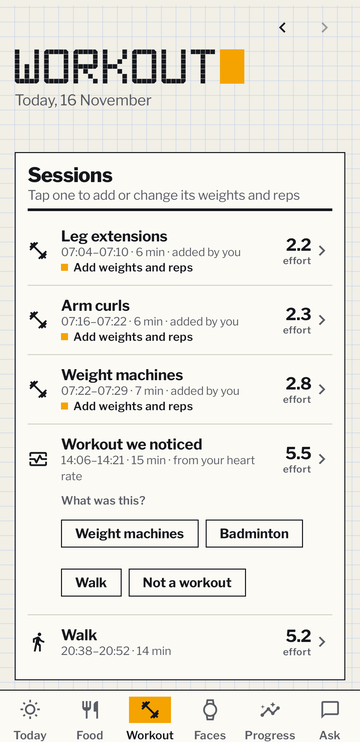
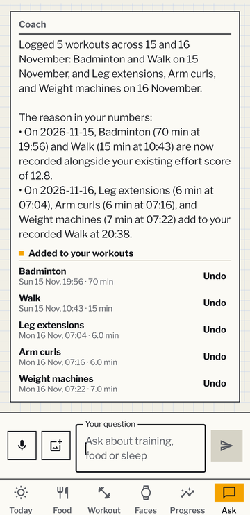
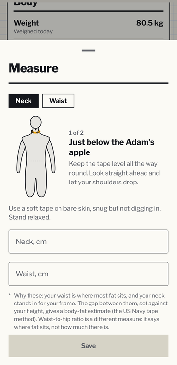

<h1 align="center">Bandmate</h1>

<b>A free Android app for the Galaxy Fit 3: watch faces you send from your phone, and a coach that turns your watch's data into a plan for the day.</b>

<a href="../../releases/latest"><b>⬇ Download the latest version</b></a>

  
  
  

## What it does

| Tab | What it's for |
|---|---|
| **Today** | A plan in three lines: how hard to train, how much protein and how many calories are left, and when to go to bed. Sleep stages, heart rate and effort are there if you want the detail. |
| **Food** | Take a photo or say what you ate; the AI works out protein and calories, cooking oil included. Meals can go on earlier days too. |
| **Workout** | Every session from your watch, with effort from your heart rate. Tap one to log weights and reps. Sessions the Health app didn't pass on can be added from a screenshot of its workout list. |
| **Faces** | Packs of watch faces, sent to the band straight from the phone. |
| **Progress** | Where your body is heading, from weight, waist, lifts and food, with a guide showing exactly where to measure. |
| **Ask** | Talk or type to the coach. Tell it what you ate or trained and it goes into your log, with an Undo. |

  
  
  

## Install

1. Open the [latest release](../../releases/latest) on your phone and tap **Bandmate-x.y.z.apk** to download it.
2. Open the downloaded file. Android asks you to allow **Install unknown apps** for your browser or file manager the first time; allow it, then tap **Install**.
3. Open Bandmate. Setup takes about three minutes, and every step ticks itself off when it's done.

**You need:** a Galaxy Fit 3, an Android phone running Android 9 or newer, Samsung Health and Galaxy Wearable, set up as usual.

**Updating:** download the new APK and install it over the old one. Everything you've logged stays. The [Obtainium](https://github.com/ImranR98/Obtainium) app can watch this page and update Bandmate for you.

**Checking the file:** each release lists the APK's SHA-256. On a PC, `certutil -hashfile Bandmate-x.y.z.apk SHA256` (Windows) or `sha256sum Bandmate-x.y.z.apk` should print the same value.

## Setup, step by step

The app walks you through this the first time it opens:

1. **Watch data:** let Bandmate read Health Connect, let Samsung Health share with Health Connect, and set Samsung Health's battery use to Unrestricted so your data isn't held back for hours.
2. **AI coach (optional):** get a free Gemini key from Google AI Studio. The app opens the page, pastes the key and checks it. Flash Lite is the default model; it's free and rarely busy. Everything else works without a key.
3. **Watch faces:** allow Nearby devices and find your watch once. The first time, a screen asks whether Bandmate may connect; tap Allow.

Then a short tour shows what each tab is for. Settings has **Setup and tour** to run either again.

## Watch faces

Two packs come with the app: **Digital Classic** (11 faces) and **Dot Theme** (5). Any other pack is a `.f3pack` file: open it with Bandmate, or tap **+** in Faces, and it's added.

**Good to know:**
- Each face in a pack is built on top of one of the watch's original faces, and Bandmate needs that original face on your phone once. For now the way to get one is [FitFace Studio](https://github.com/satvikgosai/fitface-studio) (free): download the face there, export it, and open the export with Bandmate. A face that says "Needs the original face" is waiting for this.
- Sending takes one extra step each time: switch the Fit3 Plugin's Nearby devices off for a minute so Bandmate can reach the band, then back on. The app tells you when.
- Faces numbered 201 to 250 install beside your other faces. The rest replace the original face they're built on.

## Privacy

- What you enter (meals, lifts, weight, chat) stays on your phone. No accounts, no ads, no analytics.
- **Health Connect:** read only (heart rate, sleep, workouts, steps, distance, calories, blood oxygen, weight). Nothing is written back.
- **Nearby devices:** only to send faces to the band.
- **Microphone:** only while you tap the mic to talk.
- **Camera and photos:** only the photos you pick.
- **AI coach:** a short summary of your recent days goes to Google's Gemini only when you use it, through your own key. On Google's free tier, Google may use what you send to improve its products.

## Support

Bandmate is free. If it helps you, the **Support Bandmate** button at the bottom of the Today tab takes a tip by UPI (from India) or [Ko-fi](https://ko-fi.com/thispollution5399) (from anywhere). Bug reports and ideas are just as welcome in [Issues](../../issues).

## Known limits

- Samsung Health doesn't pass every workout on to other apps, and never their names. The screenshot import is the workaround.
- The Fit 3 doesn't record heart-rate variability, so "recovery" is an estimate. Bandmate is not medical advice.
- Android only.

## Credits

Made with ♥ by Shreyash Royzada. Sending faces uses open-source code from [FitFace Studio](https://github.com/satvikgosai/fitface-studio) (MIT licence; see [FITFACE-LICENSE.txt](FITFACE-LICENSE.txt)). Watch face packs are licensed CC BY-NC 4.0.

Bandmate is an independent app. It isn't made or endorsed by Samsung or Google. Galaxy, Galaxy Fit and Samsung Health are trademarks of Samsung Electronics; Health Connect and Gemini are trademarks of Google.
