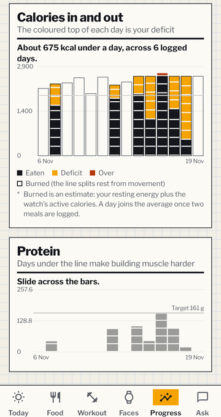
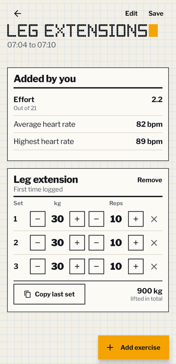
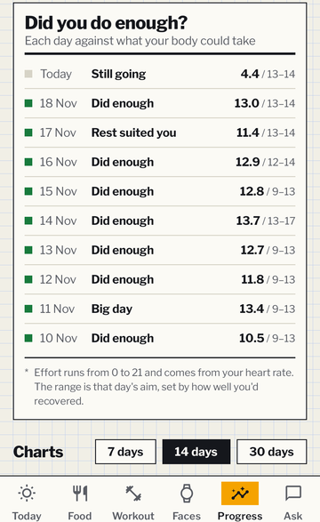
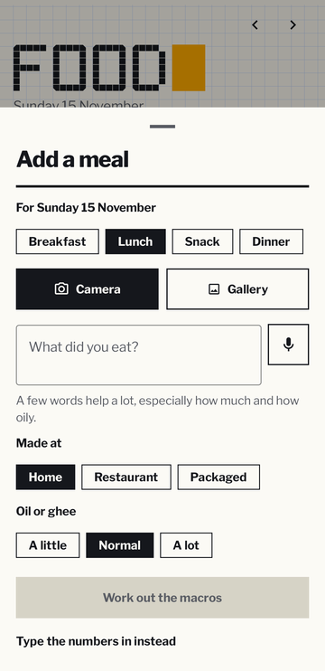
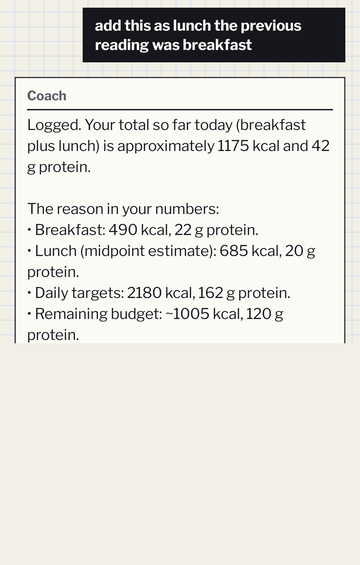

<h1 align="center">Bandmate</h1>

<b>My Galaxy Fit 3 tracked everything but never told me what it meant. Bandmate turns its data into a daily plan and a progress report, with food, lifts, an AI coach and watch faces in one free app.</b>

<a href="../../releases/latest"><b>⬇ Download the latest version</b></a>

  
  
  

## Why I built it

| The problem | What Bandmate does |
|---|---|
| **"Is my body actually changing?"** Samsung Health records everything but never says where you're heading. | Reads your weight trend, waist and a body-fat estimate, food, lifts and sleep together, and gives one verdict on where you're heading. |
| **"Should I push today or back off?"** The Fit 3 has no heart-rate variability, so there's no recovery or strain score. | Estimates both from last night's sleep, your sleeping heart rate against your normal, and how hard yesterday was. Each morning: train hard, as normal, or keep it light. A rough read, and it says so, but better than nothing. |
| **"I log food in Gemini, then copy the numbers somewhere else."** | Photo or voice in; protein and calories logged next to your training. Meals can go on earlier days, and a mess menu sent once gets you suggestions. |
| **"My sets and weights are in a notes app."** | Every workout from the watch, with its sets and weights attached, and your best lifts tracked in Progress. Workouts the Health app skipped come in from one screenshot. |
| **"I screenshot Samsung Health just to ask an AI how I'm doing."** | The coach already has your sleep, heart rate, workouts, meals and lifts. Ask by text or voice; say what you ate or trained and it logs it. Runs on a free Gemini key, about 2,000 tokens a question. |
| **"My watch faces are scattered across folders and a PC."** | Face packs live in the app and go to the band from the phone. |
| **"Am I in a deficit? Hitting protein? Sleeping enough?"** | Charts over 7, 14 or 30 days: calories in and out, protein, weight, effort, sleep and heart rate. |

  
  
  

## The tabs

| Tab | What it's for |
|---|---|
| **Today** | How hard to train, how much protein and how many calories are left, and when to go to bed. |
| **Food** | Meals by photo, voice or a few words. |
| **Workout** | Every session, with effort from heart rate, and its sets and weights. |
| **Faces** | Your face packs, sent to the band. Digital Classic (11 faces) and Dot Theme (5) come with the app. |
| **Progress** | Where your body is heading, and the charts behind it. |
| **Ask** | The coach, by text or voice. |

## Install

1. Open the [latest release](../../releases/latest) on your phone and tap **Bandmate-x.y.z.apk** to download it.
2. Open the downloaded file. Android asks you to allow **Install unknown apps** for your browser or file manager the first time; allow it, then tap **Install**.
3. Open Bandmate. Setup takes about three minutes, and every step ticks itself off when it's done.

**You need:** a Galaxy Fit 3, an Android phone running Android 9 or newer, Samsung Health and Galaxy Wearable, set up as usual.

**Updating:** download the new APK and install it over the old one. Everything you've logged stays. The [Obtainium](https://github.com/ImranR98/Obtainium) app can watch this page and update Bandmate for you.

**Checking the file:** each release lists the APK's SHA-256. On a PC, `certutil -hashfile Bandmate-x.y.z.apk SHA256` (Windows) or `sha256sum Bandmate-x.y.z.apk` should print the same value.

## Setup, step by step

The app walks you through this the first time it opens:

1. **Watch data:** let Bandmate read Health Connect, let Samsung Health share with Health Connect, and set Samsung Health's battery use to Unrestricted so your data isn't held back for hours.
2. **AI coach (optional):** get a free Gemini key from Google AI Studio. The app opens the page, pastes the key and checks it. Flash Lite is the default model; it's free and rarely busy. Everything else works without a key.
3. **Watch faces:** allow Nearby devices and find your watch once. The first time, a screen asks whether Bandmate may connect; tap Allow.

Then a short tour shows what each tab is for. Settings has **Setup and tour** to run either again.

## Watch faces

Any pack is a `.f3pack` file: open it with Bandmate, or tap **+** in Faces, and it's added.

**Good to know:**
- Each face in a pack is built on top of one of the watch's original faces, and Bandmate needs that original face on your phone once. For now the way to get one is [FitFace Studio](https://github.com/satvikgosai/fitface-studio) (free): download the face there, export it, and open the export with Bandmate. A face that says "Needs the original face" is waiting for this.
- Sending takes one extra step each time: switch the Fit3 Plugin's Nearby devices off for a minute so Bandmate can reach the band, then back on. The app tells you when.
- Faces numbered 201 to 250 install beside your other faces. The rest replace the original face they're built on.

## What it asks permission for

- **Health Connect:** to read heart rate, sleep, workouts, steps, distance, calories, blood oxygen and weight. It never writes anything back.
- **Nearby devices:** to send faces to the band.
- **Microphone:** only while you tap the mic to talk.
- **Camera and photos:** only the photos you pick.
- **AI coach:** when you use it, a short summary of your recent days goes to Google's Gemini through your own key. On Google's free tier, Google may use what you send to improve its products.

## Support

Bandmate is free. If it helps you, the **Support Bandmate** button at the bottom of the Today tab takes a tip by UPI (from India) or [Ko-fi](https://ko-fi.com/thispollution5399) (from anywhere). Bug reports and ideas are just as welcome in [Issues](../../issues).

## Known limits

- Samsung Health doesn't pass every workout on to other apps, and never their names. The screenshot import is the workaround.
- The Fit 3 doesn't record heart-rate variability, so "recovery" is an estimate. Bandmate is not medical advice.
- Android only.

## Credits

Made with ♥ by Shreyash Royzada. Sending faces uses open-source code from [FitFace Studio](https://github.com/satvikgosai/fitface-studio) (MIT licence; see [FITFACE-LICENSE.txt](FITFACE-LICENSE.txt)). Watch face packs are licensed CC BY-NC 4.0.

Bandmate is an independent app. It isn't made or endorsed by Samsung or Google. Galaxy, Galaxy Fit and Samsung Health are trademarks of Samsung Electronics; Health Connect and Gemini are trademarks of Google.
